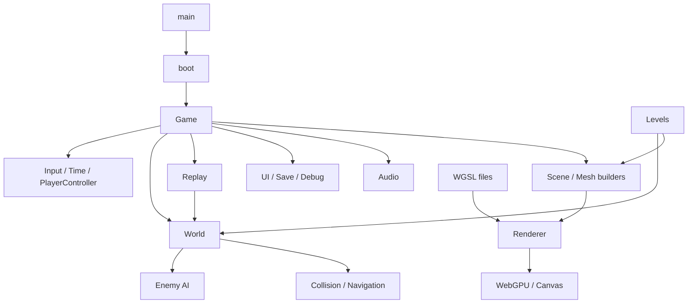

# Part 2 — Modular TypeScript migration

The inline legacy game is now a Vite application. This is a behaviour-preserving extraction and typing pass: all 19 audit findings remain unresolved, including the blocked first-level Play path and reversed time-scale arguments. Manual browser verification is still pending.

## Structure and responsibilities

| Location | Responsibility |
| --- | --- |
| `index.html` | Canvas, overlay and unsupported-browser panel; loads the entry point. |
| `src/main.ts`, `boot.ts` | Minimal entry/error handler; WebGPU initialization and game startup. |
| `src/game.ts` | Existing orchestration, state transitions, event presentation and render preparation. |
| `src/core/` | Input, animation loop/time accumulator, time-scale driver, vector helpers and RNG. |
| `src/gameplay/` | World/combat/props/waves, enemy AI, weapons, player controller and replay. |
| `src/physics/` | Static collision/intersection queries and navigation grid. |
| `src/levels/levels.ts` | Level builder and all original level definitions. |
| `src/graphics/` | GPU/canvas, mesh buffers/builders, renderer, camera, themes, scene/mesh library, poses, effects and viewmodel. |
| `src/shaders/` | Nine unchanged WGSL source strings, imported with Vite `?raw`. |
| `src/audio/` | Procedural effects, music and Web Audio routing. |
| `src/ui/` | DOM menus/HUD, saves/settings and debug overlay. |
| `src/types.ts` | Entity, level, input-frame, event, UI, scene and shared-static contracts. |
| `src/style.css` | Original stylesheet extracted verbatim. |
| `.vscode/` | Development/production F5 launch profiles and server tasks. |



## Decisions and dependencies

- Modules follow subsystem ownership so changes can be reviewed without navigating thousands of unrelated lines. Existing algorithms and state ownership stay intact; `World` and `Game` remain relatively large to keep this migration reviewable. Further decomposition can be a later increment.
- Explicit imports replace shared module scope. Cross-subsystem type references use `import type`, preventing runtime dependency cycles. Shared types describe mutable arrays without changing their allocation or representation.
- Meaningful types cover items, enemies, player state, props, projectiles, recorded frames, level definitions, settings/results, GPU targets and batches. World events use a discriminated union. GPU objects use WebGPU interfaces; DOM selectors use element types. Assertions at known DOM/level-data boundaries add no runtime branches. JSON save handling retains its existing validation behaviour.
- `strict: true` remains enabled. `npm run typecheck` includes every game `.ts` file, not just Vite configuration. No explicit `any`, suppression directives or disabled source checks are used. WGSL is bundled as text: TypeScript/build success does not validate GPU shader compilation.
- `wgpu-matrix` remains exactly **3.4.2**. Vite remains **8.3.8**, with `@webgpu/types` **0.1.74** and `@types/node` **22.20.7**. TypeScript is pinned to **5.9.3** to provide the JavaScript compiler API used for migration comparison and strict checking. The lockfile records the change. No framework was introduced.
- Relative asset base and production source maps remain enabled. Both launch profiles use Chrome and map breakpoints to TypeScript source. Select the desired profile in VS Code's Run and Debug menu, then press F5. Stop an already-running server on that profile's port before starting its task; strict ports prevent silently launching against a different URL.

## Batches and validation

1. Extracted CSS, shaders and subsystem code; ran strict checking to expose untyped legacy boundaries.
2. Added domain contracts, browser/GPU types and explicit dependencies; repeated strict checks until the complete source passed.
3. Built production assets, checked preservation, and added launch profiles/documentation.

Commands:

```sh
npm ci
npm run typecheck
npm run dev          # http://localhost:5173
npm run build
npm run preview      # http://localhost:4173
node scripts/check-preservation.cjs
```

Confirmed automated verification results:

| Check | Result |
| --- | --- |
| TypeScript compilation (`npm run typecheck`) | Passed for the actual game source. |
| Production build (`npm run build`) | Passed; **44 modules transformed**. |
| Runtime declaration comparison | `Runtime declarations differing: []`. |
| CSS and shader preservation | CSS and all **9 shader strings preserved byte-for-byte**. |

The preservation script compares runtime declarations after TypeScript erasure against baseline commit `af3e29c`, normalizing whitespace and the class-expression names changed during extraction. This checks static equivalence, not browser rendering or performance. The script requires the baseline commit to remain in Git history, as required by the lab.

The existing `BUGS.md` evidence uses original HTML locations. Its migration location map identifies the new modules; the original baseline remains available with `git show af3e29c:index.html`. No additional functional bug was identified while extracting and typing; no repeat audit was performed.

## Manual checks still required

**Pending:** manual Chrome verification and F5 launch/debugging checks in both development and production profiles have not been performed.

Open both development and preview URLs in Chrome with WebGPU available. Compare title screen, menus, settings, audio and Console/Network output with the original baseline, then test TypeScript breakpoints in both F5 profiles. Record actual browser observations separately. The known first-level unlock bug should still prevent normal fresh-player entry; this migration does not establish that levels are playable or that all visuals are correct.
